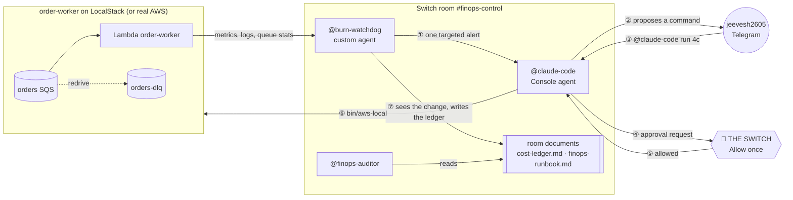

# BurnSwitch

**A Switch room where two AI agents and one human stop a runaway AWS bill together, and no live change happens until the human flips the switch.**

Built for the _Flip the Switch_ hackathon, Track 01.

> 🎬 Demo video: _coming soon_

## The problem

One bad deploy can quietly burn money all night. Here's the classic case:

1. A new client starts sending orders in a slightly different shape.
2. The Lambda worker throws on them.
3. With no dead-letter queue and no partial batch reporting, SQS retries the whole batch, forever. The good orders in that batch go down with the bad one.

Invocations and errors climb, and nobody notices until the bill arrives. Fixing it means spotting the burn, finding the cause, pausing the consumer without losing orders, shipping a patch and recovering in the right order. Those are four different jobs, and the risky ones change production.

Today that means a human copying alerts between a dashboard, a chat and a terminal at 2 a.m. Hand it all to one autonomous agent instead, and nobody signs off on the risky commands.

## The solution

BurnSwitch puts the whole incident in one **Switch room**, `#finops-control`, bridged to a Telegram group:

| Participant         | Role                                                                                                            | Runs where                       |
| ------------------- | --------------------------------------------------------------------------------------------------------------- | -------------------------------- |
| **@burn-watchdog**  | Prices the Lambda's spend every 15 s, opens one incident when it burns, hands it off once, and keeps the ledger | This repo, a custom Switch agent |
| **@claude-code**    | Reproduces the bug, writes the patch and tests, proposes each command, and runs it only after approval          | Switch Console, in `scenario/`   |
| **jeevesh2605**     | The on-call human. Approves or declines every live change from a phone                                          | Telegram                         |
| **@finops-auditor** | Joins at the end and writes the post-mortem from the ledger                                                     | Switch Console                   |

The switch is the human's **Allow once** tap. Each live command (pause, deploy, reconfigure, resume, move) is its own approval. The watchdog then records every change in a shared ledger, with the command behind it and the human request it answered.

### What a run looks like

These figures are from a recorded run (INC-20261106-0606-72b8):

- **Alert in about 1 minute.** The burn reached 12.4× the healthy baseline.
- **Contained in 3m 06s** (from the alert to the pause command). Resolved in 6m 30s.
- **6 live changes, 6 approved.** Each was requested in Telegram, approved, and traced to its command.
- **No orders lost.** 1198 sent = 955 processed + 0 queued + 243 in the DLQ. The DLQ holds only the malformed orders; nothing was purged or deleted.
- **Cost avoided (est.): $0.84.** That's (peak − baseline) × 8 h, assuming the storm would otherwise run until someone checked the bill the next morning. The traffic is demo-sized; real traffic scales the figure.

## How we use Switch



There is one switch per live change. Steps ③–⑥ repeat for pause, deploy, ReportBatchItemFailures, the redrive policy, resume and the DLQ move. Nothing reaches AWS without passing ④.

| Switch feature                                                         | How BurnSwitch uses it                                                                                                      |
| ---------------------------------------------------------------------- | --------------------------------------------------------------------------------------------------------------------------- |
| **Rooms** with a messaging bridge                                      | One room holds the whole incident. It's bridged to a Telegram group, so the human works from a phone                        |
| **Custom agent** (agent protocol: WebSocket events + HTTP ops)         | @burn-watchdog registers, keeps a resumable WebSocket, reconnects with backoff, and follows Switch when Console moves ports |
| **Targeted messages** (`send_targeted_message`)                        | Exactly one alert per incident, addressed to @claude-code, with a loop guard so the agents never ping-pong                  |
| **Console agents** (Claude Code in a folder)                           | @claude-code works in `scenario/`, with permission rules that make every live command ask, every time                       |
| **Approval requests**                                                  | Each live command becomes an Allow / Deny card in Telegram: _the switch_                                                    |
| **Room documents** (`create/update/delete_room_document`)              | `cost-ledger.md`, the incident record that all agents read, and `finops-runbook.md`, published from this repo               |
| **Room instructions** (`update_room`)                                  | The rules every agent follows: never purge, reproduce first, one command per approval, record everything                    |
| **Room events and shared context** (`read_context`, `list_references`) | The watchdog reads room messages to pair your "run …" requests with changes; the auditor reads the thread and the ledger    |
| **Room commands** (`!reset`, `!invite-agent`, `!list-documents`)       | Clean runs and late joiners (the auditor arrives only for the post-mortem)                                                  |

More detail: [docs/architecture.md](docs/architecture.md).

## Our approach

- **The watchdog watches cost, not just errors.** It prices requests and GB-seconds from `config/pricing.json`, compares that against a rolling healthy baseline, and opens an incident only when burn, error rate _and_ receive counts all stay high. There is one incident at a time, with no duplicate alerts.
- **Agents hand off once; humans decide.** The watchdog addresses @claude-code exactly once per incident. After that, agents talk only to the human, and every live change is one command with one approval.
- **Contain without losing anything.** Containment is reserved concurrency 0, and nothing is ever purged. `bin/aws-local` refuses purge and delete commands, and raw `aws` is denied.
- **Recover in a safe order, enforced in code:** deploy → ReportBatchItemFailures → redrive policy → check → resume → move the DLQ back. `bin/aws-local` refuses to resume until the redrive policy and ReportBatchItemFailures are both verified. Resuming then dead-letters the good orders stuck in the storm (their receive counts are already above 3), so the last step moves them back, and they get processed.
- **Trust, but verify.** The watchdog doesn't take the agents' word for anything. It diffs the infra on every sample, traces each change to its command in `.state/change-log.jsonl`, pairs it with the human's request, and reconciles every order sent against processed + queued + DLQ.

## Quickstart

You'll need Docker, Node 20+, the AWS CLI v2, Switch Console (Local Switch server) and a Telegram bot. The full walkthrough is [docs/setup.md](docs/setup.md).

```bash
npm install
cp .env.example .env              # LocalStack token, Switch registration key, ONCALL_NAME
npm run watchdog:register         # registers @burn-watchdog and saves its API key to .env
npm run preflight                 # checks Docker, prices, Switch and the room
npm run demo:reset -- --room "finops-control"   # clean LocalStack, empty ledger, agents and rules in the room
npm run rehearse                  # starts the burn and cues you act by act
```

Then, in Telegram, follow the cues: `@claude-code run 3a`, tap **Allow once**, and so on. Read the ledger any time with `npm run ledger:show`.

Everything runs on LocalStack by default. Real AWS is opt-in with `--real-aws`, behind a typed account-id confirmation.

## Repo map

```
scenario/   the "production" system: order-worker Lambda (ships with the bug), LocalStack infra,
            traffic generator, and bin/ helpers that @claude-code uses
watchdog/   @burn-watchdog: Switch client, metrics, cost model, detection, ledger
room/       room instructions, the runbook, instructions for @claude-code and @finops-auditor
config/     thresholds.json, pricing.json
scripts/    preflight, rehearse, demo-reset
docs/       setup guide, architecture
```

## Known limitations

- **Agents can't see who tapped Allow.** Switch stores the answer (`answered_by`), but no agent operation returns it. The ledger therefore pairs each change with the human's "run …" message and @claude-code's "Approved by" line, and the auditor says so.
- **Demo-scale money.** The dollar figures are small because the traffic is. "Cost avoided" is an estimate based on a stated assumption (8 unnoticed hours), not a measurement.
- **LocalStack metrics are partial.** It emits only Invocations and Errors, so the watchdog derives duration from Lambda `REPORT` log lines. The CloudWatch adapter exists for real AWS.
- **The real-AWS path** (`--real-aws`) is built and guarded, but our recorded runs used LocalStack.
- **Telegram can't open room documents.** Use `npm run ledger:show`. Every ledger update also posts a short "📄 updated room document" notice in the room; Switch adds it, and it can't be turned off.
- **Scope:** one function, one incident at a time.

## License

MIT. See [LICENSE](LICENSE).
