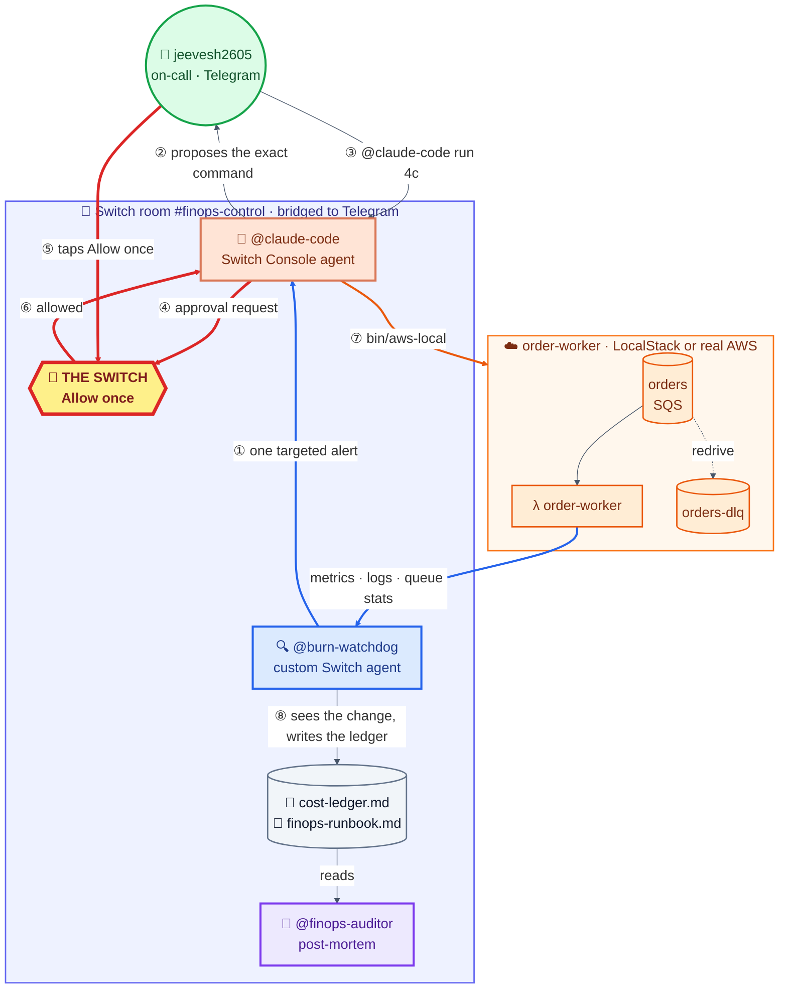
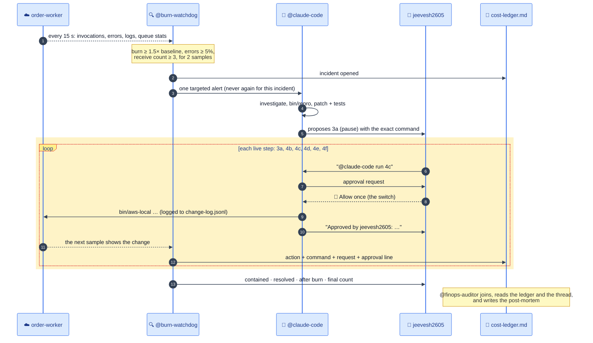

# BurnSwitch

**A Switch room where two AI agents and one human stop a runaway AWS bill together, and no live change happens until the human flips the switch.**

Built for the _Flip the Switch_ hackathon, Track 01.

> 🎬 Demo video: _coming soon_

## The problem

One bad deploy can quietly burn money all night. Here's the classic case:

1. A new client starts sending orders in a slightly different shape.
2. The Lambda worker throws on them.
3. With no dead-letter queue and no partial batch reporting, SQS retries the whole batch, forever. The good orders in that batch go down with the bad one.

Invocations and errors climb, and nobody notices until the bill arrives. Fixing it means spotting the burn, finding the cause, pausing the consumer without losing orders, shipping a patch and recovering in the right order. Those are four different jobs, and the risky ones change production.

Today that means a human copying alerts between a dashboard, a chat and a terminal at 2 a.m. Hand it all to one autonomous agent instead, and nobody signs off on the risky commands.

## The solution

BurnSwitch puts the whole incident in one **Switch room**, `#finops-control`, bridged to a Telegram group:

| Participant         | Role                                                                                                            | Runs where                       |
| ------------------- | --------------------------------------------------------------------------------------------------------------- | -------------------------------- |
| **@burn-watchdog**  | Prices the Lambda's spend every 15 s, opens one incident when it burns, hands it off once, and keeps the ledger | This repo, a custom Switch agent |
| **@claude-code**    | Reproduces the bug, writes the patch and tests, proposes each command, and runs it only after approval          | Switch Console, in `scenario/`   |
| **jeevesh2605**     | The on-call human. Approves or declines every live change from a phone                                          | Telegram                         |
| **@finops-auditor** | Joins at the end and writes the post-mortem from the ledger                                                     | Switch Console                   |

The switch is the human's **Allow once** tap. Each live command (pause, deploy, reconfigure, resume, move) is its own approval. The watchdog then records every change in a shared ledger, with the command behind it and the human request it answered.

### What a run looks like

These figures are from a recorded run (INC-20261106-0606-72b8):

- **Alert in about 1 minute.** The burn reached 12.4× the healthy baseline.
- **Contained in 3m 06s** (from the alert to the pause command). Resolved in 6m 30s.
- **6 live changes, 6 approved.** Each was requested in Telegram, approved, and traced to its command.
- **No orders lost.** 1198 sent = 955 processed + 0 queued + 243 in the DLQ. The DLQ holds only the malformed orders; nothing was purged or deleted.
- **Cost avoided (est.): $0.84.** That's (peak − baseline) × 8 h, assuming the storm would otherwise run until someone checked the bill the next morning. The traffic is demo-sized; real traffic scales the figure.

## Architecture



There is one switch per live change. Steps ③–⑦ repeat for pause, deploy, ReportBatchItemFailures, the redrive policy, resume and the DLQ move. Nothing reaches AWS without passing the switch.

### The incident, step by step



### How we use Switch

| Switch feature                                                         | How BurnSwitch uses it                                                                                                      |
| ---------------------------------------------------------------------- | --------------------------------------------------------------------------------------------------------------------------- |
| **Rooms** with a messaging bridge                                      | One room holds the whole incident. It's bridged to a Telegram group, so the human works from a phone                        |
| **Custom agent** (agent protocol: WebSocket events + HTTP ops)         | @burn-watchdog registers, keeps a resumable WebSocket, reconnects with backoff, and follows Switch when Console moves ports |
| **Targeted messages** (`send_targeted_message`)                        | Exactly one alert per incident, addressed to @claude-code, with a loop guard so the agents never ping-pong                  |
| **Console agents** (Claude Code in a folder)                           | @claude-code works in `scenario/`, with permission rules that make every live command ask, every time                       |
| **Approval requests**                                                  | Each live command becomes an Allow / Deny card in Telegram: _the switch_                                                    |
| **Room documents** (`create/update/delete_room_document`)              | `cost-ledger.md`, the incident record that all agents read, and `finops-runbook.md`, published from this repo               |
| **Room instructions** (`update_room`)                                  | The rules every agent follows: never purge, reproduce first, one command per approval, record everything                    |
| **Room events and shared context** (`read_context`, `list_references`) | The watchdog reads room messages to pair your "run …" requests with changes; the auditor reads the thread and the ledger    |
| **Room commands** (`!reset`, `!invite-agent`, `!list-documents`)       | Clean runs and late joiners (the auditor arrives only for the post-mortem)                                                  |

### The switch: one approval per live change

Nothing changes production without the human's tap. Four layers enforce this:

1. **Room instructions** (`room/instructions.md`): one command per approval, run only when jeevesh2605 asks, answer **Allow once**.
2. **Claude Code permission rules** (`scenario/.claude/settings.json`):
   - every mutating `bin/aws-local` and `bin/deploy-worker` command is an `ask` rule;
   - ask rules prompt every time, even after "Allow for this session" and in bypass mode;
   - raw `aws`, `purge-queue`, `delete-message` and `delete-queue` are denied.
3. **Switch** turns each prompt into an Allow / Deny card in the Telegram group.
4. **The helpers refuse unsafe commands.** `bin/aws-local` refuses purge and delete, and refuses to restore concurrency until `bin/recovery-check` passes.

Switch records who answered each card (`answered_by`), but no agent operation returns it. So the watchdog pairs each change with two things it _can_ see:

- the human's "run …" message (same kind of change, up to 2 min before the command);
- @claude-code's "Approved by …" line.

### Inside @burn-watchdog

| Part                     | File(s)                             | What it does                                                                                                                                                                                                                                      |
| ------------------------ | ----------------------------------- | ------------------------------------------------------------------------------------------------------------------------------------------------------------------------------------------------------------------------------------------------- |
| Switch client            | `watchdog/src/switch/`              | Registration, WebSocket with ping/pong, resume tickets, backoff and rebase when Console changes ports; HTTP ops with transient-error retry and a dry-run mode                                                                                     |
| Metrics                  | `watchdog/src/metrics/`             | `localstack-probe` (Invocations/Errors plus duration from `REPORT` log lines), `cloudwatch` (real AWS), `replay` (fixtures). Also reads queue counts, receive counts, concurrency, redrive, code SHA and the mapping                              |
| Cost model               | `watchdog/src/cost/model.ts`        | USD/hr = requests × rate + GB-seconds × rate, with the rates from `config/pricing.json`                                                                                                                                                           |
| Detector                 | `watchdog/src/incident/detector.ts` | Rolling healthy baseline; burning → contained → resolved; at most one open incident. A rehearsal reset closes an open incident as _abandoned_                                                                                                     |
| Timeline and attribution | `timeline.ts`, `changes.ts`         | Diffs the infra on every sample and traces each change to its command in `.state/change-log.jsonl` (source `agent` or `setup`). A change seen before its log line is retried for 2 min. Each change is paired with a request and an approval line |
| Reconciliation           | `reconcile.ts`                      | Sent (from the traffic generator's exact counts) = processed (distinct order ids priced in completed invocations) + queued + DLQ. Once the queue is empty, it splits the DLQ into malformed and good                                              |
| Summary figures          | `summary.ts`                        | Time to contain = alert → the containment command. Cost avoided = (peak − baseline) × `cost.unnoticed_hours`. The after burn is measured only once the backlog has drained                                                                        |
| Ledger                   | `watchdog/src/ledger/`              | Renders `cost-ledger.md` as a room document. It embeds the watchdog's state in a hidden marker, so a lost `.state/` folder is restored from Switch. It also publishes `finops-runbook.md`                                                         |
| Outbox                   | `index.ts`                          | Alerts and updates wait in an outbox until Switch accepts them, so an outage delays a message but never loses it                                                                                                                                  |

### The recovery order

| Step | Change                                        | Why                                                                                 |
| ---- | --------------------------------------------- | ----------------------------------------------------------------------------------- |
| 3a   | Reserved concurrency 0                        | Stops the burn at once; every message stays on the queue                            |
| 4b   | Deploy the patch                              | Validates the payload, doesn't retry validation errors, returns `batchItemFailures` |
| 4c   | ReportBatchItemFailures on the mapping        | A bad order fails alone; the rest of its batch succeeds                             |
| 4d   | Redrive policy: orders-dlq, maxReceiveCount 3 | Failing messages stop after 3 tries                                                 |
| 4e   | `bin/recovery-check`, then resume             | Resuming is refused until 4c and 4d are both verified                               |
| 4f   | Move the DLQ back to `orders`                 | Brings back the good orders that resuming dead-lettered                             |

Step 4f exists because SQS dead-letters a message on receive once its receive count is above `maxReceiveCount`, whatever the code does with it. The good orders stuck in the storm already have counts of 10–120, so they go to the DLQ on the first poll after resuming. A move (`sqs start-message-move-task`) restarts every message at receive count 0. The good orders are then processed, and the malformed ones fail 3 more times and return. The run ends with only malformed orders in the DLQ.

## Our approach

- **Watch cost, not just errors.** The watchdog prices requests and GB-seconds from `config/pricing.json` (prices are never hardcoded) and compares them with a rolling healthy baseline. It opens an incident only when burn, error rate _and_ receive counts all stay high: one incident at a time, with no duplicate alerts.
- **Agents hand off once; humans decide.** The watchdog addresses @claude-code exactly once per incident. After that, agents talk only to the human, and every live change is one command with one approval.
- **Contain without losing anything.** Containment is reserved concurrency 0. Nothing in the code purges or deletes messages, and raw `aws` is denied.
- **Trust, but verify.** The watchdog doesn't take the agents' word for anything. It diffs the infra on every sample, traces each change to its command, pairs it with the human's request, and reconciles every order sent against processed + queued + DLQ.
- **Safe by default.** Everything runs on LocalStack unless you pass `--real-aws`, which needs a typed account id, prints a banner on every call and comes with a teardown script (`scenario:down`). Secrets live only in `.env` (gitignored). `demo:reset` makes every run repeatable.

## Quickstart

You'll need Docker, Node 20+, the AWS CLI v2, Switch Console (Local Switch server) and a Telegram bot. The full walkthrough is [docs/setup.md](docs/setup.md).

```bash
npm install
cp .env.example .env              # LocalStack token, Switch registration key, ONCALL_NAME
npm run watchdog:register         # registers @burn-watchdog and saves its API key to .env
npm run preflight                 # checks Docker, prices, Switch and the room
npm run demo:reset -- --room "finops-control"   # clean LocalStack, empty ledger, agents and rules in the room
npm run rehearse                  # starts the burn and cues you act by act
```

Then, in Telegram, follow the cues: `@claude-code run 3a`, tap **Allow once**, and so on. Read the ledger any time with `npm run ledger:show`.

## Repo map

```
scenario/   the "production" system: order-worker Lambda (ships with the bug), LocalStack infra,
            traffic generator, and bin/ helpers that @claude-code uses
watchdog/   @burn-watchdog: Switch client, metrics, cost model, detection, ledger
room/       room instructions, the runbook, instructions for @claude-code and @finops-auditor
config/     thresholds.json, pricing.json
scripts/    preflight, rehearse, demo-reset
docs/       setup guide and troubleshooting
```

## Known limitations

- **Agents can't see who tapped Allow.** Switch stores the answer (`answered_by`), but no agent operation returns it. The ledger therefore pairs each change with the human's "run …" message and @claude-code's "Approved by" line, and the auditor says so.
- **Demo-scale money.** The dollar figures are small because the traffic is. "Cost avoided" is an estimate based on a stated assumption (8 unnoticed hours), not a measurement.
- **LocalStack metrics are partial.** It emits only Invocations and Errors, so the watchdog derives duration from Lambda `REPORT` log lines. The CloudWatch adapter exists for real AWS.
- **The real-AWS path** (`--real-aws`) is built and guarded, but our recorded runs used LocalStack.
- **Telegram can't open room documents.** Use `npm run ledger:show`. Every ledger update also posts a short "📄 updated room document" notice in the room; Switch adds it, and it can't be turned off.
- **Scope:** one function, one incident at a time.

## License

MIT. See [LICENSE](LICENSE).
