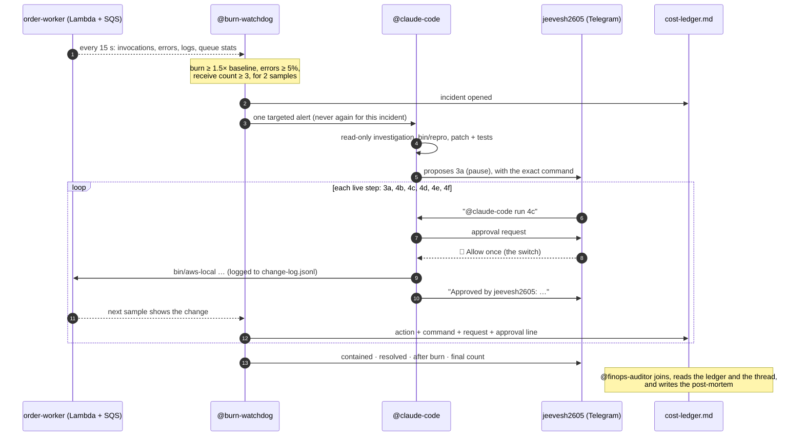

# Architecture

How BurnSwitch's pieces fit together, and why each decision was made. For setup, see [setup.md](setup.md).

## The incident, end to end

## The switch: one approval per live change

Nothing changes production without the human's tap. Four layers enforce this:

1. **Room instructions** (`room/instructions.md`): one command per approval, run only when jeevesh2605 asks, answer **Allow once**.
2. **Claude Code permission rules** (`scenario/.claude/settings.json`):
   - every mutating `bin/aws-local` and `bin/deploy-worker` command is an `ask` rule;
   - ask rules prompt every time, even after "Allow for this session" and in bypass mode;
   - raw `aws`, `purge-queue`, `delete-message` and `delete-queue` are denied.
3. **Switch** turns each prompt into an Allow / Deny card in the Telegram group.
4. **The helpers refuse unsafe commands.** `bin/aws-local` refuses purge and delete, and refuses to restore concurrency until `bin/recovery-check` passes.

Switch records who answered each card (`answered_by`), but no agent operation returns it. So the watchdog pairs each change with two things it _can_ see:

- the human's "run …" message (same kind of change, up to 2 min before the command);
- @claude-code's "Approved by …" line.

## @burn-watchdog

| Part                     | File(s)                             | What it does                                                                                                                                                                                                                                      |
| ------------------------ | ----------------------------------- | ------------------------------------------------------------------------------------------------------------------------------------------------------------------------------------------------------------------------------------------------- |
| Switch client            | `watchdog/src/switch/`              | Registration, WebSocket with ping/pong, resume tickets, backoff and rebase when Console changes ports; HTTP ops with transient-error retry and a dry-run mode                                                                                     |
| Metrics                  | `watchdog/src/metrics/`             | `localstack-probe` (Invocations/Errors plus duration from `REPORT` log lines), `cloudwatch` (real AWS), `replay` (fixtures). Also reads queue counts, receive counts, concurrency, redrive, code SHA and the mapping                              |
| Cost model               | `watchdog/src/cost/model.ts`        | USD/hr = requests × rate + GB-seconds × rate, with the rates from `config/pricing.json`                                                                                                                                                           |
| Detector                 | `watchdog/src/incident/detector.ts` | Rolling healthy baseline; burning → contained → resolved; at most one open incident. A rehearsal reset closes an open incident as _abandoned_                                                                                                     |
| Timeline and attribution | `timeline.ts`, `changes.ts`         | Diffs the infra on every sample and traces each change to its command in `.state/change-log.jsonl` (source `agent` or `setup`). A change seen before its log line is retried for 2 min. Each change is paired with a request and an approval line |
| Reconciliation           | `reconcile.ts`                      | Sent (from the traffic generator's exact counts) = processed (distinct order ids priced in completed invocations) + queued + DLQ. Once the queue is empty, it splits the DLQ into malformed and good                                              |
| Summary figures          | `summary.ts`                        | Time to contain = alert → the containment command. Cost avoided = (peak − baseline) × `cost.unnoticed_hours`. The after burn is measured only once the backlog has drained                                                                        |
| Ledger                   | `watchdog/src/ledger/`              | Renders `cost-ledger.md` as a room document. It embeds the watchdog's state in a hidden marker, so a lost `.state/` folder is restored from Switch. It also publishes `finops-runbook.md`                                                         |
| Outbox                   | `index.ts`                          | Alerts and updates wait in an outbox until Switch accepts them, so an outage delays a message but never loses it                                                                                                                                  |

## The recovery order

| Step | Change                                        | Why                                                                                 |
| ---- | --------------------------------------------- | ----------------------------------------------------------------------------------- |
| 3a   | Reserved concurrency 0                        | Stops the burn at once; every message stays on the queue                            |
| 4b   | Deploy the patch                              | Validates the payload, doesn't retry validation errors, returns `batchItemFailures` |
| 4c   | ReportBatchItemFailures on the mapping        | A bad order fails alone; the rest of its batch succeeds                             |
| 4d   | Redrive policy: orders-dlq, maxReceiveCount 3 | Failing messages stop after 3 tries                                                 |
| 4e   | `bin/recovery-check`, then resume             | Resuming is refused until 4c and 4d are both verified                               |
| 4f   | Move the DLQ back to `orders`                 | Brings back the good orders that resuming dead-lettered                             |

Step 4f exists because SQS dead-letters a message on receive once its receive count is above `maxReceiveCount`, whatever the code does with it. The good orders stuck in the storm already have counts of 10–120, so they go to the DLQ on the first poll after resuming. A move (`sqs start-message-move-task`) restarts every message at receive count 0. The good orders are then processed, and the malformed ones fail 3 more times and return. The run ends with only malformed orders in the DLQ.

## Safety rails

- **Messages:** no purge or delete anywhere in the code; containment pauses consumption instead.
- **Real AWS:** LocalStack by default. `--real-aws` needs a typed account id, prints a banner on every call, and has a teardown script (`scenario:down`).
- **Secrets:** only in `.env` (gitignored).
- **Prices:** never hardcoded; they come from `config/pricing.json`.
- **Agent loop:** the watchdog addresses @claude-code once per incident. Agents talk to the human, not to each other.
- **Repeatable demo:** `demo:reset` archives the state, deletes the ledger, recreates LocalStack with the buggy worker, and sets up the room.
